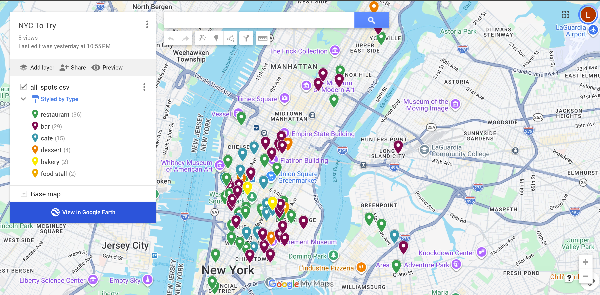

# NYC Spots

**A monthly AI workflow that turns the NYC bars and restaurants I save on TikTok into pins on a Google map.**

I save food spots on TikTok constantly, then never find them again when I'm deciding where to go. This script reads my TikTok export, uses Claude to work out which videos are about NYC food and drink places, looks each one up on Google, and produces a file I import into Google My Maps.



## Results

The first full run read 270 saved videos and mapped **88 NYC spots**: 36 restaurants, 29 bars, 15 cafes, 4 dessert spots, 2 bakeries and 2 food stalls. It flagged 44 videos to check by hand, mostly ones where the creator says the name out loud but never writes it.

## How it works

1. **Read the export.** Finds every saved and liked video in TikTok's "Download your data" file (JSON).
2. **Get each video's details.** Reads the video page for the caption, creator and location tag.
3. **Claude decides what's a place.** For each video: is it about a food or drink place, is it in NYC, and what's the name, neighborhood, type and vibe? Claude fills in a fixed form (tool use), so the answer always comes back as structured data, and it never guesses names that aren't in the video.
4. **Google finds it.** The Google Places API returns the exact address and map link, and the script checks the location is actually inside NYC.
5. **Write the files.** New spots for My Maps, a short "check by hand" list, and a running list of everything.

It remembers what it has already processed, so each month it only reads new videos and never creates duplicate pins.

## What broke and how I fixed it

- **Every caption came back blank.** The export's links don't include the creator's username, so TikTok's embed service answered without the caption. I wrote small test scripts to compare six ways of reading a video, then switched to the video page, which also gives the location tag.
- **A theater ended up on the map.** I limited Claude to a fixed list of food and drink types and added a code check that drops anything else.
- **The run crashed on one malformed AI answer.** I switched to tool use instead of free-text JSON. Any batch that still fails is split in half and retried instead of stopping the run.

## Built with

Python, the Claude API (Haiku, tool use), the Google Places API (New) and Google My Maps. Built with Claude as my coding partner.

## Run it yourself

1. Install Python, then `pip install -r requirements.txt`.
2. Get a Claude API key (console.anthropic.com) and a Google Cloud key with **Places API (New)** enabled.
3. Set them as environment variables: `ANTHROPIC_API_KEY` and `GOOGLE_MAPS_API_KEY`.
4. Request your TikTok data (Settings → Account → Download your data → Likes and Favorites → JSON).
5. Try it on the sample first, which makes no API calls:
   ```
   python nyc_spots.py sample_export.json --dry-run
   ```
6. Run it on your own export:
   ```
   python nyc_spots.py user_data_tiktok.json --saved-only --limit 30
   ```
7. Import the `spots_<date>.csv` file into Google My Maps (Latitude and Longitude for position, Name for the title).

| Option | Does |
| --- | --- |
| `--dry-run` | Count videos only, no API calls |
| `--saved-only` | Skip likes |
| `--since 2026-01-01` | Only videos from that date on |
| `--limit 30` | Process at most 30 new videos |
| `--yes` | Don't ask before big runs |

## Limitations and what's next

- It only reads text, so names that are only spoken in the video are missed. Next: audio transcription.
- TikTok only for now. Next: Instagram saves.
- Next: run automatically each month.

## Privacy

Your TikTok export, the script's memory file (`spots_state.json`) and the CSVs it produces contain your personal data. They're excluded by `.gitignore` and never belong in a public repo. Google Places data shouldn't be stored long-term either, so refresh it from the place IDs rather than publishing old copies.
